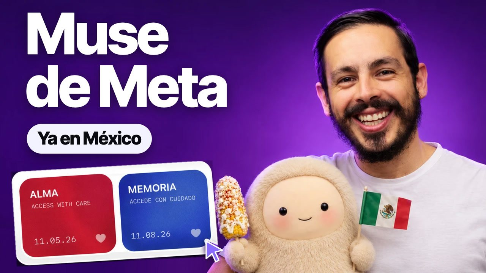
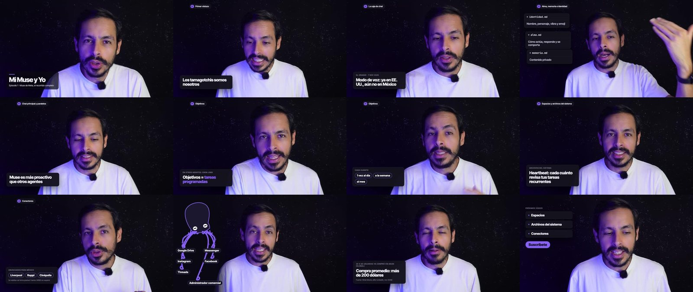
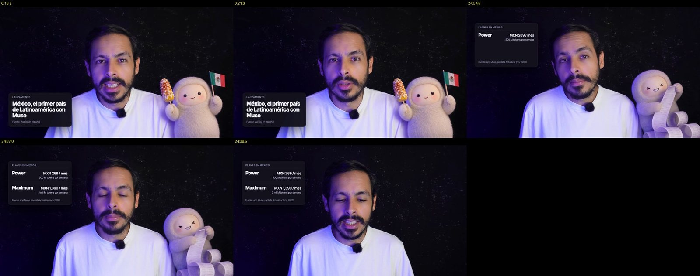
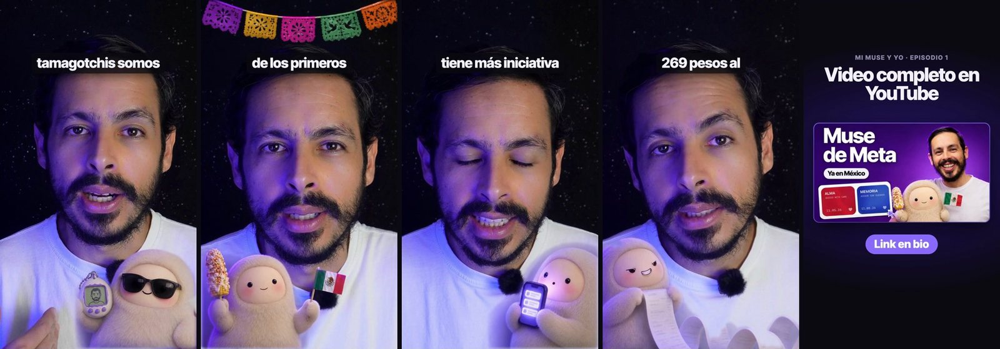

# video-largo-y-teaser

Skill para Claude que convierte horas de grabación a cámara (con o sin grabaciones de pantalla) en un
**episodio largo de YouTube editado en código** (ffmpeg + escenas TypeScript/GSAP) y además produce un
**teaser 9:16** que lo promociona. También entrega miniatura, ficha de publicación, transcripción y subtítulos y,
si quieres, un **personaje hecho con IA** metido en tomas reales.

Todo el corte vive en archivos (EDL anclada a frases → `cortes.json` → piezas ffmpeg). Cada ronda de notas
se resuelve con un re-render parcial en vez de re-editar a mano.



## Tu identidad, no la del ejemplo

La skill define el **proceso**, no el look. Antes de diseñar nada, Claude carga tu skill de marca si la tienes o te
pregunta: serie, colores, tipografía, encuadres, subtítulos, sonido, tono, miniatura y personaje. Luego te ofrece
guardar las respuestas como tu propia skill de marca a partir de `assets/plantilla-marca/`. Si no tienes
preferencias, te propone 2 o 3 direcciones hechas con tu material para que elijas.

El ejemplo de abajo es de otra persona: su paleta morada, sus fuentes y su mascota no se usan como default.

## Ejemplo real: «Mi Muse y Yo», episodio 1

La skill salió de este proyecto: 25:52 min con 12 capítulos, a partir de dos clips 4K de cámara y nueve grabaciones de pantalla.
Lo grabó y presenta [Pablo Paredes](https://github.com/wavexlabs-dev) (nov 2026).

**Gráficos anclados a frases.** Rótulos con fuente, píldora de capítulo y analogías dibujadas en código, siempre en la
columna libre, nunca sobre la cara.



**Personaje IA en tomas reales.** El clip completo de Seedance 2.5 se integra con la voz original y se mide la
sincronía de la boca (≥ 0.75).



**Teaser 9:16 de ~30 s.** Gancho, frases que abren preguntas, destellos de la app y cierre que manda al video
completo.



## El proceso (13 pasos, con paradas ◆ de aprobación)

1. Intake + identidad (tu marca o tus respuestas) ◆
2. Transcribir (whisper con tiempos por palabra) y sincronizar pantalla ↔ cámara por audio
3. Estructura de capítulos ◆
4. Style frames ◆
5. Corte en bruto: EDL → cortes → concat ◆
6. Gráficos y alternancia cámara/pantalla
7. Mezcla (−15 LUFS para YouTube, −1.5 dBTP)
8. Crítico: un subagente nuevo revisa contra las reglas aprendidas
9. Versiones `_V2`, `_V3`…
10. Miniatura ◆
11. Teaser 9:16 ◆
12. Personaje IA (opcional, se cotiza antes) ◆
13. Publicación: título, descripción, capítulos, transcripción `.md` para NotebookLM y `.srt`

## Qué incluye

```
SKILL.md                     proceso y reglas que más pesan
references/                  identidad, flujo de corte, teaser, personaje IA, publicación, reglas aprendidas
scripts/
  transcribir.sh             palabras con tiempo (mlx-whisper o whisper) + wav por clip
  sincronizar_pantalla.py    desfase pantalla ↔ cámara por correlación de audio
  alinear_clip_ia.py         integra un clip de Seedance con la voz original y mide la boca
assets/plantilla-marca/      plantilla en blanco para crear tu skill de marca
assets/pipeline-referencia/  el pipeline real del EP1 (corte, teaser, escenas, personaje) para copiar y adaptar
docs/                        imágenes de este README
```

## Instalación

```bash
git clone https://github.com/wavexlabs-dev/video-largo-y-teaser ~/.claude/skills/video-largo-y-teaser
```

Requiere Python 3 con numpy, ffmpeg/ffprobe y whisper (`mlx-whisper` en Mac con Apple Silicon u `openai-whisper`).
Para las escenas animadas, la skill hermana [estudio-video-codigo](https://github.com/wavexlabs-dev/estudio-video-codigo).
El personaje IA es opcional y de pago (Seedance 2.5 vía Higgsfield o Sume).

## Uso

Pásale a Claude la carpeta con tus clips: «edita mi video, aquí están los clips y las grabaciones de pantalla».
Si tienes una skill de marca (p. ej. `marca-<tu-nombre>-video`), Claude la carga encima: esta define el proceso y
la de marca define el look.

El pipeline de referencia trae rutas y nombres de clip del proyecto original, así que hay que leer cada script antes de usarlo.
Los scripts de privacidad (`blur.py`, `privacy_check.py`) traen patrones genéricos: pon ahí los tuyos y no los
subas a un repo público.

## Licencia

MIT
